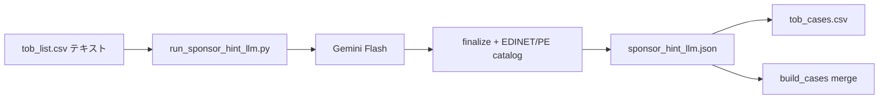

# SponsorHint LLM（CSV テキスト → Gemini）

Enrich 済みの `tob_list.csv` テキスト（`PurposesRaw` 等）を Gemini に渡し、**経済的スポンサー（実質的な買収者）** を特定して `SponsorHint` を更新する Action です。PDF 取得は不要です。

## 想定フロー



1. **テキスト集約** — 届出書（240/250）の `PurposesRaw` / `OverviewRaw` 等を CaseID 単位で束ねる
2. **Gemini 推論** — 融資銀行・代理人を除外し、PE / 上場親会社 / 直接買付 / 非上場 SPV を JSON で返す
3. **post-process** — 既存の `sanitize_sponsor_name` + EDINET 上場 lookup + PE catalog で `SponsorHint` 形式に正規化
4. **sidecar 保存** — `output/current/sponsor_hint_llm.json`（`build_cases()` が merge）
5. **diff 出力** — ルール結果との比較 CSV

## 必要な環境変数

| 変数 | 用途 |
|---|---|
| `GEMINI_API_KEY` | Gemini API（`GOOGLE_API_KEY` でも可） |

## 使い方（ローカル）

```bash
# ドライラン（API 不要）
python experiments/sponsor-hint-llm/scripts/run_sponsor_hint_llm.py --dry-run --limit 5

# blank 17 件だけ
python experiments/sponsor-hint-llm/scripts/run_sponsor_hint_llm.py --only-blank --apply-cases

# 全 465 件（無料枠: ~9 RPM、約 2 日）
python experiments/sponsor-hint-llm/scripts/run_sponsor_hint_llm.py --limit 50 --offset 0
python experiments/sponsor-hint-llm/scripts/run_sponsor_hint_llm.py --limit 50 --offset 50
# ...

# 1 案件だけ試す
python experiments/sponsor-hint-llm/scripts/run_sponsor_hint_llm.py --case-id S100QBV1 --apply-cases
```

## GitHub Actions

Workflow: **Sponsor Hint LLM** — **入力なし。Run workflow を押すだけ。**

1 回の実行で最大 **10 件**（SponsorHint が空の案件を優先 → 未処理案件）。
完了したらもう一度 Run を押して次の 10 件。全件終わるまで繰り返します。

| 以前（複雑） | 現在（簡素） |
|---|---|
| mode / limit / offset / model を選ぶ | **入力なし** |
| モデル名を手動更新 | **API が使えるモデルを自動選択** |

## 出力ファイル

| パス | 内容 |
|---|---|
| `output/current/sponsor_hint_llm.json` | CaseID → LLM 結果（本番 merge 用） |
| `experiments/sponsor-hint-llm/output/sponsor_hint_diff.csv` | ルール vs LLM 比較 |

## 本番パイプラインとの関係

| | ルール (`resolve_sponsor_hint`) | この Action |
|---|---|---|
| 入力 | XBRL 抽出テキスト | 同じ CSV テキスト |
| 出力 | `SponsorHint` | sidecar → `SponsorHint` 上書き |
| 優先 | sidecar 無し時 | **sidecar 有り時は LLM を優先** |

Enrich / Fetch 再実行後も sidecar が残れば `build_cases()` で LLM 結果が反映されます。

## なぜ何度も失敗していたか（根本原因）

| # | 現象 | 原因 | 対策（今回） |
|---|---|---|---|
| 1 | HTTP 404 | ハードコードしたモデル名が **API キー世代ごとに異なる** | ListModels API から **自動選択** |
| 2 | 16秒で即失敗 | workflow **offset に `--limit 10` と入力** | **入力欄を廃止** |
| 3 | UnboundLocalError | `gemini_client.py` の **バグ**（404/429 後に payload 未設定のまま処理） | ループ構造を修正 |
| 4 | （将来）429 | 無料枠 RPM | 1 回 **10 件** + リトライ |

**Gemini が難しいのではなく**、「モデル名の陳腐化」「UI の入力ミス」「未テストのエラー経路」が重なっていました。

### データ量の目安

- 1 案件 ≒ テキスト **~4,000〜14,000 文字**（`PurposesRaw` 中心）
- blank 17 件 ≒ **~17 API 呼び出し**（無料枠 250 RPD 内）
- 全 465 件 ≒ **2 日程度**（10 件/回 × 分割実行推奨）

Gemini が難しいのではなく、**モデル名の更新頻度**と **workflow 入力**に注意が必要です。

```bash
# 利用可能モデル一覧（API キー要）
python experiments/sponsor-hint-llm/scripts/run_sponsor_hint_llm.py --list-models
```

## モジュール

- `tob/sponsor_hint_llm.py` — テキスト集約、プロンプト、post-process、sidecar I/O
- `experiments/sponsor-hint-llm/scripts/run_sponsor_hint_llm.py` — CLI / batch runner
