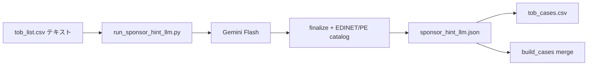

# SponsorHint LLM（CSV テキスト → Gemini）

Enrich 済みの `tob_list.csv` テキスト（`PurposesRaw` 等）を Gemini に渡し、**経済的スポンサー（実質的な買収者）** を特定して `SponsorHint` を更新する Action です。PDF 取得は不要です。

## 想定フロー



1. **テキスト集約** — 届出書（240/250）の `PurposesRaw` / `OverviewRaw` 等を CaseID 単位で束ねる
2. **Gemini 推論** — 融資銀行・代理人を除外し、PE / 上場親会社 / 直接買付 / 非上場 SPV を JSON で返す
3. **post-process** — 既存の `sanitize_sponsor_name` + EDINET 上場 lookup + PE catalog で `SponsorHint` 形式に正規化
4. **sidecar 保存** — `output/current/sponsor_hint_llm.json`（`build_cases()` が merge）
5. **diff 出力** — ルール結果との比較 CSV

## 必要な環境変数

| 変数 | 用途 |
|---|---|
| `GEMINI_API_KEY` | Gemini API（`GOOGLE_API_KEY` でも可） |

## 使い方（ローカル）

```bash
# ドライラン（API 不要）
python experiments/sponsor-hint-llm/scripts/run_sponsor_hint_llm.py --dry-run --limit 5

# blank 17 件だけ
python experiments/sponsor-hint-llm/scripts/run_sponsor_hint_llm.py --only-blank --apply-cases

# 全 465 件（無料枠: ~9 RPM、約 2 日）
python experiments/sponsor-hint-llm/scripts/run_sponsor_hint_llm.py --limit 50 --offset 0
python experiments/sponsor-hint-llm/scripts/run_sponsor_hint_llm.py --limit 50 --offset 50
# ...

# 1 案件だけ試す
python experiments/sponsor-hint-llm/scripts/run_sponsor_hint_llm.py --case-id S100QBV1 --apply-cases
```

## GitHub Actions

Workflow: **Sponsor Hint LLM**（手動 `workflow_dispatch`）

| 入力 | 説明 |
|---|---|
| `mode` | `blank` / `batch` / `all` / `dry_run` |
| `limit` | batch モードの件数（既定 50） |
| `offset` | batch オフセット |
| `apply_cases` | 完了後 `tob_cases.csv` を更新 |

## 出力ファイル

| パス | 内容 |
|---|---|
| `output/current/sponsor_hint_llm.json` | CaseID → LLM 結果（本番 merge 用） |
| `experiments/sponsor-hint-llm/output/sponsor_hint_diff.csv` | ルール vs LLM 比較 |

## 本番パイプラインとの関係

| | ルール (`resolve_sponsor_hint`) | この Action |
|---|---|---|
| 入力 | XBRL 抽出テキスト | 同じ CSV テキスト |
| 出力 | `SponsorHint` | sidecar → `SponsorHint` 上書き |
| 優先 | sidecar 無し時 | **sidecar 有り時は LLM を優先** |

Enrich / Fetch 再実行後も sidecar が残れば `build_cases()` で LLM 結果が反映されます。

## モジュール

- `tob/sponsor_hint_llm.py` — テキスト集約、プロンプト、post-process、sidecar I/O
- `experiments/sponsor-hint-llm/scripts/run_sponsor_hint_llm.py` — CLI / batch runner
